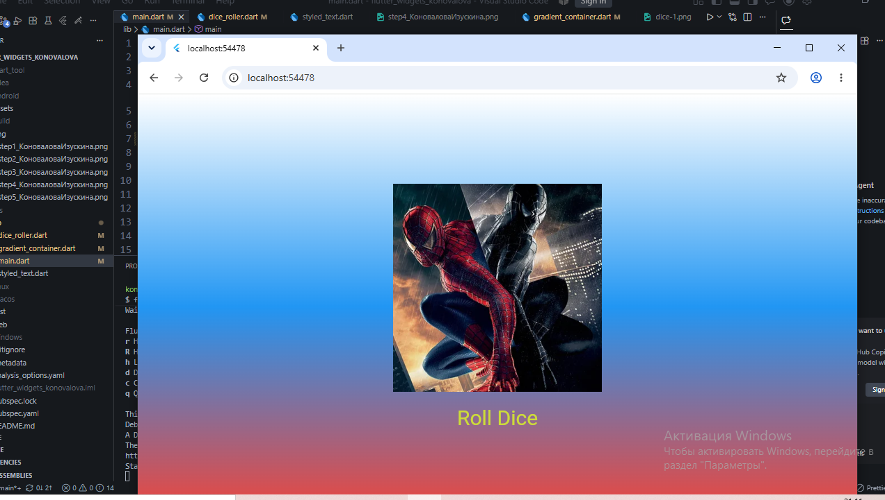

# Лабораторная работа №4-5. Flutter: структура UI и компонентный подход

**ФИО:** Коновалова Ангелина
**Группа:** ИСП242
**Дата сдачи:** 20.11.2026

## Что изучили

- Научились строить UI через дерево виджетов и разбивать сложный интерфейс на отдельные компоненты.
- Освоили создание собственных виджетов (`StatelessWidget`) и вынос их в отдельные файлы для чистоты кода.
- Познакомились с передачей данных в виджеты через параметры конструктора.
- Изучили управление состоянием с помощью `StatefulWidget` и функции `setState()`.
- Научились подключать и отображать локальные изображения (assets) и генерировать случайные числа.

## Скриншот финального приложения

## Ссылка на репозиторий

[GitHub - Flutter_Widgets](https://github.com/sdcfghj54546/Flutter_Widgets.git)

## Инструкция по запуску

1. Клонировать репозиторий: `git clone https://github.com/sdcfghj54546/Flutter_Widgets.git`
2. Перейти в папку проекта: `cd flutter_widgets_konovalova`
3. Выполнить `flutter pub get`
4. Запустить командой `flutter run -d chrome`

## Ответы на вопросы

**1. Зачем выносить виджеты в отдельные файлы? Что изменится если держать всё в main.dart?**
Вынос виджетов делает код чище, понятнее и позволяет переиспользовать компоненты в разных частях приложения. Если держать всё в `main.dart`, файл быстро разрастется до тысяч строк, в нем станет невозможно ориентироваться, а любые изменения будут влиять на весь файл целиком (риск сломать что-то другое).

**2. Что такое BuildContext? Почему метод build() принимает его как параметр?**
`BuildContext` — это ссылка на местоположение виджета в дереве виджетов. Метод `build()` принимает его, чтобы виджет знал, где именно он находится. Это нужно, например, чтобы узнать размеры родительского контейнера, получить доступ к теме приложения или вызвать навигацию. Без контекста виджет не сможет правильно отрисоваться.

**3. Чем StatelessWidget отличается от StatefulWidget? Приведите пример когда нужен каждый из них.**
`StatelessWidget` — это неизменяемый виджет. Он отрисовывается один раз и не меняется (например, статичный текст или иконка). `StatefulWidget` — это виджет с изменяемым состоянием, который может перерисовываться с помощью `setState()`. Пример `StatelessWidget`: шапка сайта или фон. Пример `StatefulWidget`: кнопка лайка (меняет цвет), форма ввода или наш кубик, который меняет картинку при нажатии.

**4. Почему Random() создаётся на уровне файла, а не внутри rollDice()?**
Создание нового объекта `Random()` при каждом нажатии кнопки — это неэффективная трата ресурсов. Создав его один раз на уровне файла, мы переиспользуем один и тот же экземпляр. Кроме того, новый генератор, созданный внутри функции, может использовать текущее время как зерно (seed), что иногда приводит к предсказуемым результатам при быстрых нажатиях.
